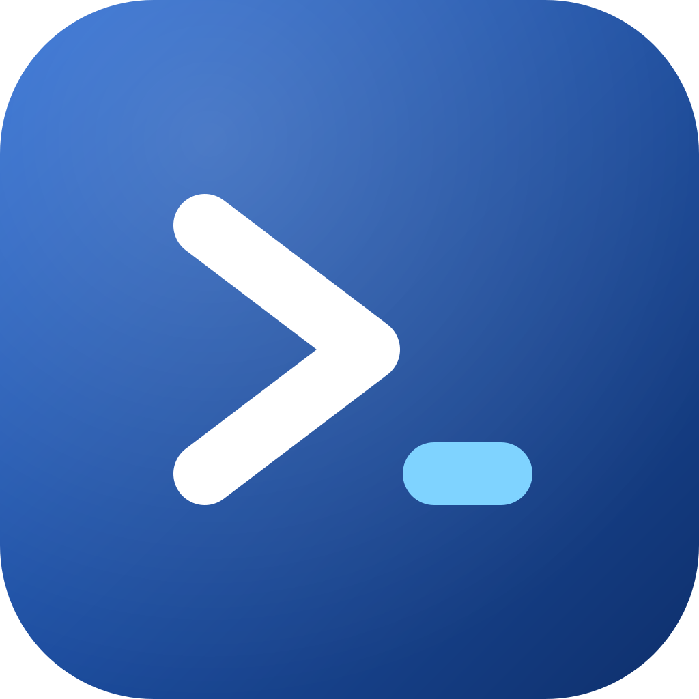

<!-- Authoring guidance: dev-docs/specs/README_SPEC.instructions.md -->
<!-- rumdl-disable MD033 MD041 -->

  

<h1 align="center">PowerShell Practice</h1>

  An app that helps PowerShell beginners learn everyday cmdlets and test
  themselves with quick quizzes.

  
  
  
  

<!-- rumdl-enable MD033 MD041 -->

---

## About

PowerShell has hundreds of commands, and remembering their names, aliases, and
syntax takes practice. PowerShell Practice gives you a pocket reference of
common cmdlets, from getting help and working with files to the pipeline,
processes, output, and networking, along with quizzes that check what you
remember. Everything works on your device, with no account and no PowerShell
connection needed. The app runs on Android phones and tablets and on iPhone
and iPad, and is available on
[Google Play](https://play.google.com/store/apps/details?id=com.plaintxtoffice.powershellpractice)
and the [App Store](https://apps.apple.com/app/id6837567736).

## Features

- Browse common cmdlets in seven categories, or search by name, alias, or task.
- Read each cmdlet's summary, syntax, aliases, examples, and tips, and copy
  any command to the clipboard.
- Mark cmdlets as learned; learned cmdlets show a check mark in the list.
- Take multiple-choice or type-the-command quizzes of 5 to 30 questions on all
  cmdlets, ones you have not learned yet, ones that need review, or a single
  category.
- See your score and the cmdlets you missed at the end of each quiz.
- Practice pipelines: pick the pipeline that does a task, or build it by
  tapping cmdlets into order.
- See each cmdlet's quiz record, and quiz yourself on the cmdlets that need
  review.
- Read five short guides in the **Docs** tab, on naming rules, command
  conventions, piping techniques, variables and quoting, and comparison
  operators, each with worked examples and their output.
- Type examples into the emulator to see their recorded output. Nothing you
  type is run.
- Send a bug report or feature request from inside the app.

The next version of each platform, in development, rearranges the app into
four tabs: **Home**, **Practice**, **Emulator**, and **Docs**. **Docs** holds
the cmdlet library under **Commands** and the guides under **Guides**,
**Emulator** replaces the **Practice Terminal**, and **Home** adds a **Send
Feedback** button. The **Progress** tab and its totals are not part of that
layout; learned marks and quiz records carry over, and **Reset All Progress**
moves to the **About** section under **Docs**, **Guides**. Pipeline rounds can
have 1 to 14 questions, and the app remembers the number you choose. Version
1.1.0 has the tabs **Learn**, **Practice**, **Progress**, and **Docs**.

## Download

| Platform | Download | Notes |
| --- | --- | --- |
| Android | [Google Play](https://play.google.com/store/apps/details?id=com.plaintxtoffice.powershellpractice) | Version 1.1.0. Requires Android 8.0 or later. |
| iOS | [App Store](https://apps.apple.com/app/id6837567736) | Version 1.0.0; 1.1.0, with the guides and the practice terminal, is waiting for App Review. Requires iOS 26.5 or later on iPhone or iPad. |

## User Manual

See the [User Manual](docs/USER_MANUAL.md) for installation, setup, usage, and
troubleshooting.

## Feedback

Send bug reports and feature requests to
[support@plaintxtoffice.com](mailto:support@plaintxtoffice.com), through the
[contact page](https://plaintxtoffice.com/contact/), or in
[GitHub Issues](https://github.com/PlainTxtOffice/powershell-practice/issues).
In the app, **Send feedback** prepares an email to the same address. On
Android, find it in **More options** (three dots) on any tab or under
**About** in **Docs**. On iPhone and iPad, it is under **About** in **Docs**
from version 1.1.0, and on the **Learn** tab's toolbar in version 1.0.0. In
the next version of each platform, in development, **Send Feedback** is on the
**Home** tab and under **About** in **Docs**, **Guides**.

## License

PowerShell Practice is proprietary software owned by Plain Text Office LLC. See
[LICENSE](LICENSE) for the terms; all rights reserved.
